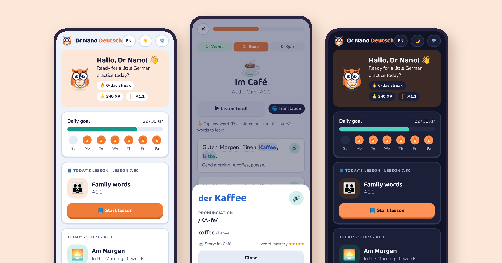
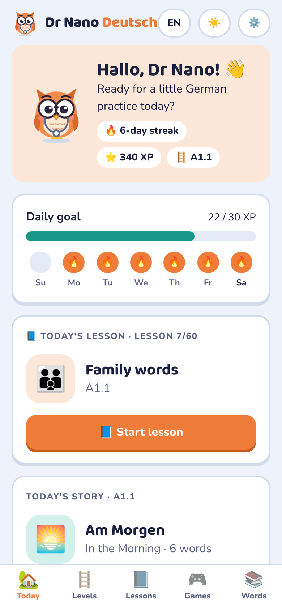
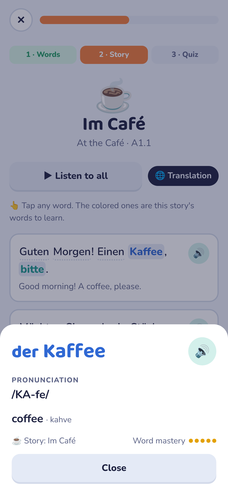
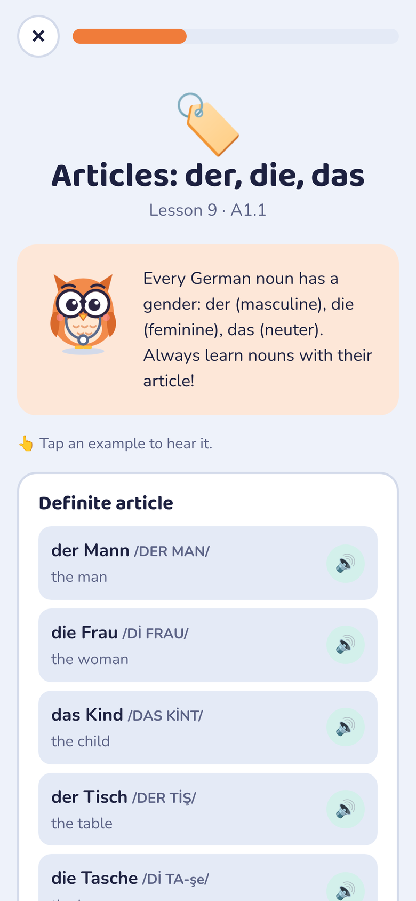
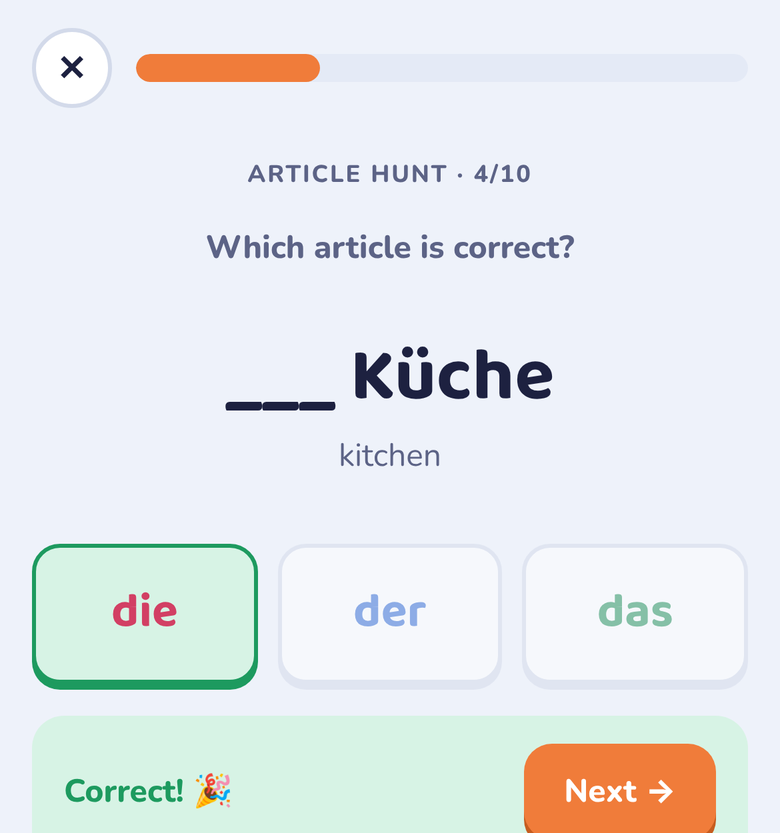
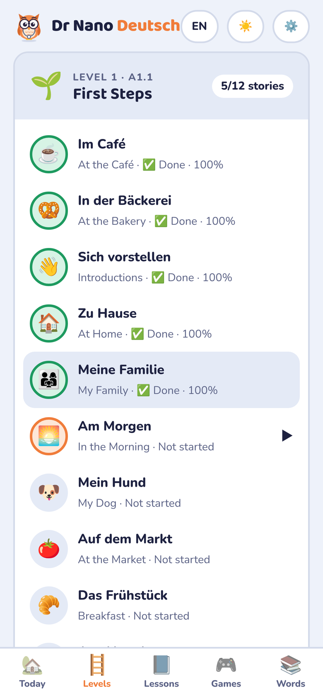
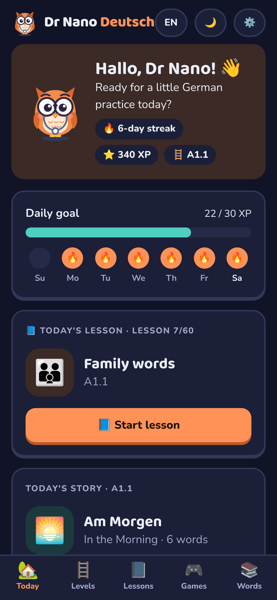

<p align="center">
  
</p>

<h1 align="center">Dr Nano Deutsch</h1>

<p align="center">
  <a href="README.md">🇹🇷 Türkçe</a> · <b>🇬🇧 English</b> · <a href="README.de.md">🇩🇪 Deutsch</a>
</p>

<p align="center">
  A personal mobile app for learning German every day with short stories, bite-sized lessons and mini games.
</p>

<p align="center">
  
  
  
  
  
</p>

<p align="center"></p>

---

## Contents

- [What's inside](#whats-inside)
- [Screenshots](#screenshots)
- [Content](#content)
- [Installation](#installation)
- [Web version (GitHub Pages)](#web-version-github-pages)
- [Project structure](#project-structure)
- [Build the APK yourself](#build-the-apk-yourself)
- [Signing and updates](#signing-and-updates)
- [Adding a story or lesson](#adding-a-story-or-lesson)
- [Data and privacy](#data-and-privacy)
- [Troubleshooting](#troubleshooting)
- [Credits](#credits)

## What's inside

**📖 Scenario-based daily stories.** 60 short stories from real life: a café, a train station, the doctor, a job interview and more. Each story has three steps:
1. Meet the new words and listen to them.
2. Read the story. Tap any word to see its meaning and pronunciation.
3. Pass the 5-question quiz with 80%.

**📘 Daily lessons.** 60 lessons that start with the alphabet and build up through numbers, telling the time and grammar to B1. Each lesson has a short explanation, examples with audio and a 5-question practice round. Lessons unlock one after another.

**🔊 Pronunciation.** Every word has a pronunciation guide written with Turkish letters, with the stressed syllable in capitals (`ŞPAY-ze-kar-te`). You can also hear each word with your device's German voice.

**🎮 Five mini games:**
- Match Up
- Quick Pick
- Letter Master
- Article Hunt (der/die/das)
- Listen & Find

Weak words come up more often, while recently practised words are pushed back, so you don't keep seeing the same ones.

**🪜 Level system.** The next level only opens when you have:
- finished the level's stories and lessons
- mastered 80% of its words
- passed the 12-question level exam

**🎨 Interface:**
- Turkish / English interface
- Light / dark / system theme
- Colour-coded articles: **der** blue, **die** red, **das** green

**🔥 Motivation.** A daily XP goal, a day streak and a weekly calendar.

**📴 Offline.** No internet needed. Fonts and all content are bundled with the app.

## Screenshots

<table>
<tr><td align="center"><b>Home</b><br></td><td align="center"><b>Story & pronunciation</b><br></td><td align="center"><b>Lesson</b><br></td></tr>
<tr><td align="center"><b>Article Hunt</b><br></td><td align="center"><b>Levels</b><br></td><td align="center"><b>Dark mode</b><br></td></tr>
</table>

## Content

Each level has 12 stories and 12 lessons. The app teaches German with Turkish explanations; the English interface translates every meaning and explanation into English.

<details>
<summary><b>🌱 A1.1 · First Steps</b></summary>

**Stories:** ☕ At the Café · 🥨 At the Bakery · 👋 Introductions · 🏠 At Home · 👨‍👩‍👧 My Family · 🌅 In the Morning · 🐶 My Dog · 🍅 At the Market · 🥐 Breakfast · 🌙 In the Evening · 🍦 At the Ice Cream Shop · 🧺 A Picnic

**Lessons:** Alphabet & sounds · Numbers 0–12 · Greetings & goodbyes · Polite phrases · Pronouns & "sein" · Introduce yourself · Family words · Countries & languages · Articles: der, die, das · Times of day · Food & drinks · Home & furniture
</details>

<details>
<summary><b>🚲 A1.2 · On the Move</b></summary>

**Stories:** 🚆 At the Train Station · 🗺️ Asking for Directions · 🏨 At the Hotel · 🛒 At the Supermarket · 🚕 By Taxi · 📞 On the Phone · 🎬 At the Cinema · 🏋️ At the Gym · 🚌 On the Bus · 🌷 At the Flower Shop · 📚 At the Library · 🏊 At the Swimming Pool

**Lessons:** Numbers 13–100 · Prices & shopping · The verb "haben" · Regular verbs · Verbs with a vowel change · Question words · Place words · Possessives: mein, dein, sein, ihr · Jobs · Negation: nicht & kein · Ja, nein, doch · Big numbers & years
</details>

<details>
<summary><b>🌤️ A2.1 · Daily Life</b></summary>

**Stories:** 🍝 At the Restaurant · 🩺 At the Doctor · ☀️ In the Park · 👕 Buying Clothes · ⚽ Free Time · 🍳 We Are Cooking · 🚗 The Car Broke Down · 📦 Moving House · 💻 A New Laptop · 🦷 At the Dentist · 🎁 Exchanging Something · 🦁 At the Zoo

**Lessons:** Telling the time · Days, months & seasons · Ordinals & dates · Colours & adjectives · Clothes · The body · gern, mögen, lieben · How often? · Quantities & measures · The accusative case · Plurals · Wo? Wohin? Two-way prepositions
</details>

<details>
<summary><b>💼 A2.2 · Work & Life</b></summary>

**Stories:** 💻 At the Office · 💊 At the Pharmacy · 🔑 Flat Hunting · 🎉 Meeting Friends · 💇 At the Hairdresser · 🎓 At the Language Course · 🏥 At the Hospital · 🏛️ At the Public Office · 🧑‍💻 Working from Home · 🔊 Too Loud! · 🐱 At the Vet · 🗺️ At the Travel Agency

**Lessons:** Modal verbs · Separable verbs · The weather · Dative & prepositions · Pronouns: accusative · Pronouns: dative · Reflexive verbs · Word order: verb second · Time prepositions · du / Sie & commands · deshalb, trotzdem, außerdem · Adjective endings
</details>

<details>
<summary><b>🧳 B1 · Travel</b></summary>

**Stories:** ✈️ At the Airport · 🏦 At the Bank · 📮 At the Post Office · 🚨 A Small Emergency · 🏖️ On Holiday · 🤝 The Job Interview · 💍 The Wedding · 🌱 Protecting the Environment · 📦 Trouble with a Delivery · 🖼️ At the Museum · 🥗 Healthy Living · 🤲 Volunteering

**Lessons:** Past tense: war & hatte · Perfekt with haben · Perfekt with sein · Simple past: telling stories · Conjunctions: und, aber, weil, dass · Clauses: wenn, als, ob · Comparison · Relative clauses · Talking about the future · zu + infinitive, um … zu · The passive · Polite forms: würde, hätte, könnte
</details>

Besides the 361 core words, the built-in dictionary covers more than 400 helper words in the stories, each with its meaning and pronunciation.

## Installation

### Android (APK)

1. Download the latest `DrNanoDeutsch.apk` to your phone from the [Releases](../../releases) page.
2. Open the file. If you see "Allow installs from unknown sources", allow it for the app you opened the file with.
3. Play Protect may warn that the app is unrecognised. That is expected for apps installed outside the Play Store; tap **Install anyway**.
4. For audio you need a German voice on your phone: **Settings → Text-to-speech → Google Text-to-speech → German**, then download the voice.

Requires Android 7.0 (API 24) or later.

## Web version (GitHub Pages)

The whole app is a single HTML file in the `docs/` folder, so it also runs in a browser.

1. Open the repository on GitHub and go to **Settings → Pages**.
2. Choose **Source:** *Deploy from a branch* · **Branch:** `main` · **Folder:** `/docs` and save.
3. A few minutes later the app is live at `https://<your-username>.github.io/dr-nano-deutsch/`

On a phone, use your browser's **Add to Home screen** option to use it like an app.

> The web version and the Android app keep separate progress. To move progress between them, use **Settings → Copy backup / Restore backup**.

## Project structure

```
dr-nano-deutsch/
├── docs/                      ← The app itself (web + APK content)
│   ├── index.html             ← All UI, content and game logic
│   ├── fonts/                 ← Baloo 2 + Nunito (offline, OFL licensed)
│   └── icon.png
├── android/                   ← Android shell (Apktool project format)
│   ├── AndroidManifest.xml
│   ├── apktool.yml            ← minSdk 24, targetSdk 34, version number
│   ├── res/                   ← Icons, light/dark theme colours
│   └── smali/com/drnano/deutsch/
│       ├── MainActivity.smali ← Full-screen WebView, back button
│       ├── Bridge.smali       ← JS ↔ Android bridge (TTS, clipboard, exit)
│       ├── Listener.smali     ← Reports when speech has finished
│       └── Done.smali
├── scripts/build-apk.sh       ← One-command APK build
└── .github/workflows/build-apk.yml  ← Automatic builds with GitHub Actions
```

### How it works

- **Interface:** The whole app is one HTML/CSS/JS file with no external dependencies.
- **Android shell:** Opens the `docs/` folder from `file:///android_asset/` in a full-screen WebView.
- **Audio:** Android's WebView does not support the browser's `speechSynthesis`, so pronunciation is sent through the `window.AndroidTTS` bridge to the phone's own **TextToSpeech** engine. In a browser, the app uses the Web Speech API directly.
- **Why not Kotlin/Gradle:** The shell is only four small classes. This way the project builds with just Java, without Android Studio or the Android SDK.

## Build the APK yourself

All you need is **Java 11+** (and internet on the first run, to download the build tools from GitHub).

```bash
bash scripts/build-apk.sh
# → dist/DrNanoDeutsch.apk
```

The script does the following, in order:
1. Downloads [Apktool](https://github.com/iBotPeaches/Apktool) and [uber-apk-signer](https://github.com/patrickfav/uber-apk-signer).
2. Copies the contents of `docs/` into the APK's `assets/` folder.
3. Builds the APK, aligns it (zipalign) and signs it with a v2/v3 signature.

To set a version number:

```bash
VERSION_CODE=2 VERSION_NAME=1.1 bash scripts/build-apk.sh
```

### Automatic builds with GitHub Actions

When you push a tag such as `v1.1`, the workflow builds the APK and attaches it to the **Releases** page:

```bash
git tag v1.1
git push origin v1.1
```

You can also run it by hand under **Actions → APK derle → Run workflow**.

## Signing and updates

Android only installs an update over an existing app if both are signed with **the same key**. If the key changes, you have to uninstall and reinstall the app, and your progress is lost. So:

- **Never commit** the `drnano.jks` key file (`.gitignore` already blocks it).
- Keep the key and its password somewhere safe (a password manager or your personal cloud).

To use the key for a local build:

```bash
KEYSTORE=~/drnano.jks KEYSTORE_PASSWORD='your-password' KEY_ALIAS=drnano bash scripts/build-apk.sh
```

To let GitHub Actions sign with the same key, add these secrets under **Settings → Secrets and variables → Actions**:

| Secret | Value |
|---|---|
| `KEYSTORE_BASE64` | Output of `base64 -w0 drnano.jks` (on macOS: `base64 -i drnano.jks`) |
| `KEYSTORE_PASSWORD` | Keystore password |
| `KEY_ALIAS` | `drnano` |
| `KEY_PASSWORD` | Key password (usually the same as the keystore password) |

If these secrets are not set, the APK is signed with a debug key. A debug-signed APK cannot be installed as an update over an app installed with the release key.

## Adding a story or lesson

All content lives in JavaScript arrays inside `docs/index.html`.

### Story

```js
{id:'cafe', e:'☕', t:{de:'Im Café', tr:'Kafede', en:'At the Café'},
 w:[ // [German, article ('der'|'die'|'das'|'pl'|''), Turkish, English, pronunciation, (inflected forms)]
   ['Kaffee','der','kahve','coffee','KA-fe'],
   ['heißen','','adı … olmak','to be called','HAY-sın',['heiße','heißt']]
 ],
 l:[ // [German line, Turkish, English] — {curly braces} mark a word to learn
   ['Guten Morgen! Einen {Kaffee}, bitte.','Günaydın! Bir kahve, lütfen.','Good morning! A coffee, please.']
 ]}
```

Add the story to the `s:[…]` array of the right level. Meanings of unmarked words come from the `GLOSS` dictionary; a word that is not in it shows as plain text. Add new helper words to `GLOSS` as `word:['Turkish','English','PRO-nun-ci-a-tion']`.

### Lesson

```js
{id:'sein', lv:0, e:'🙋', t:['Şahıs zamirleri ve "sein"','Pronouns & "sein"'],
 i:['Short intro (TR)','Short intro (EN)'],
 b:[{h:['Başlık','Heading'], p:['Explanation with **bold** support','Explanation'],
     x:[['ich bin','İH BİN','ben -im','I am']]}],      // [German, pronunciation, TR, EN]
 q:[{s:'Ich ___ müde.', o:['bin','bist','ist']},      // the FIRST option is the correct answer
    {q:['Soru (TR)','Question (EN)'], o:[['evet','yes'],['hayır','no']]}]}
```

`lv` sets the level (0 = A1.1 … 4 = B1). The lesson's position within the level comes from the `ORDER` array. Options are shuffled every time, so always write the correct answer **first**.

## Data and privacy

- The app has no server, no account and no analytics.
- Progress (level, word mastery, streak, XP) is stored only in the device's `localStorage`, under the key `drnano-deutsch-v1`.
- The Android version declares the `INTERNET` permission, but the app sends no data over the network. All content and fonts are bundled.
- Back up with **Settings → Copy backup**. This copies your progress to the clipboard as plain text (JSON); use **Restore backup** to load it again.

## Troubleshooting

| Problem | Solution |
|---|---|
| No sound | Download the German voice under **Settings → Text-to-speech** on your phone. Make sure the phone isn't on silent. |
| "App not installed" error | An older version signed with a different key is installed. Back up first, uninstall the old version, then install again. |
| Progress is gone | The app data may have been cleared. Load your latest backup with **Restore backup**. |
| No sound in the web version | Your browser or operating system has no German voice installed. Chrome and Safari usually include one. |

## Credits

- **Fonts:** [Baloo 2](https://github.com/EkType/Baloo2) and [Nunito](https://github.com/googlefonts/nunito), under the SIL Open Font License 1.1 ([docs/fonts/LICENSE.txt](docs/fonts/LICENSE.txt)).
- **Build tools:** [Apktool](https://github.com/iBotPeaches/Apktool) and [uber-apk-signer](https://github.com/patrickfav/uber-apk-signer).

---

<p align="center"><sub>Made with 🦉 for Dr Nano · Viel Erfolg beim Deutschlernen!</sub></p>
